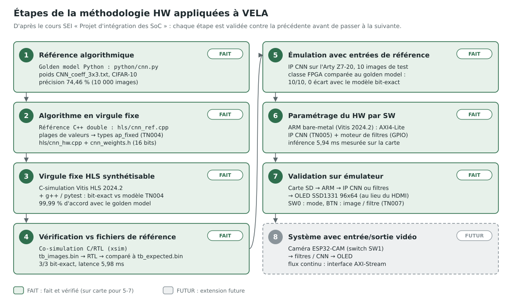

# VELA — Vision Edge Learning Accelerator

> **VELA** : **V**ision **E**dge **L**earning **A**ccelerator — plateforme embarquée de traitement d'image et d'inférence CNN sur FPGA.

Image processing and CNN inference platform on a Xilinx Zynq-7020 SoC (Digilent Arty Z7-20).  
Results displayed live on a Pmod OLED RGB (SSD1331, 96x64px).

Two operating modes, selectable via on-board switches and buttons:

- **Image filters** — Grayscale, Sobel edge detection, Gaussian blur, Median filter, Threshold (binary)
- **CNN classification** — CIFAR-10 classifier (10 categories) on 24x24 images

## Architecture overview

Visual guide (methodology, prototyping platform, CNN inference chain, animated):
[docs/TN/TN006.md](docs/TN/TN006.md).

<p align="center">
    
</p>

```
                     ┌─────────────────────────────────────────────┐
                     │              Zynq XC7Z020 SoC               │
                     │                                             │
  ┌──────────┐       │  ┌──────────────────────────────────────┐   │
  │ SD Card  │───────│──│         ARM Cortex-A9 (PS)           │   │
  └──────────┘       │  │  bare-metal: SD read, dispatch,      │   │
                     │  │  mode FSM, OLED update               │   │
  ┌──────────┐       │  └──────────┬───────────────────────────┘   │
  │ Buttons  │───────│─────────────│                               │
  │ Switches │       │             │ AXI                           │
  └──────────┘       │  ┌──────────▼───────────────────────────┐   │
                     │  │            FPGA Fabric (PL)          │   │
                     │  │                                      │   │
                     │  │  ┌─────────────┐  ┌───────────────┐  │   │
                     │  │  │ Filter IPs  │  │   CNN IP      │  │   │
                     │  │  │ (Verilog)   │  │   (HLS C++)   │  │   │
                     │  │  └──────┬──────┘  └───────┬───────┘  │   │
                     │  │         └────────┬────────┘          │   │
                     │  │                  │                   │   │
                     │  │         ┌────────▼────────┐          │   │
                     │  │         │ OLED Controller │          │   │
                     │  │         │ (Verilog + SPI) │          │   │
                     │  │         └────────┬────────┘          │   │
                     │  └──────────────────│───────────────────┘   │
                     └─────────────────────│───────────────────────┘
                                           │ SPI
                                  ┌────────▼────────┐
                                  │  Pmod OLED RGB  │
                                  │  SSD1331 96x64  │
                                  └─────────────────┘
```

## CNN architecture

```
Image 24x24x3 (CHW)
  -> Conv1(3x3, 64 filters) + ReLU + MaxPool(3x3, stride 2)  -> 12x12x64
  -> Conv2(3x3, 32 filters) + ReLU + MaxPool(3x3, stride 2)  -> 6x6x32
  -> Conv3(3x3, 20 filters) + ReLU + MaxPool(3x3, stride 2)  -> 3x3x20
  -> Reshape (HWC flatten)                                     -> 180
  -> Fully Connected (180 -> 10)                               -> 10
  -> Softmax                                                   -> probabilities
```

Pre-trained weights from `CNN_coeff_3x3.txt` (TensorFlow format, transposed to CHW at load time).

## Image filters

| Filter    | Kernel | Implementation | Description                                            |
| --------- | ------ | -------------- | ------------------------------------------------------ |
| Grayscale | —      | Verilog RTL    | RGB to luminance (0.299R + 0.587G + 0.114B)            |
| Sobel     | 3x3    | Verilog RTL    | Edge detection (horizontal + vertical gradient)        |
| Gaussian  | 3x3    | Verilog RTL    | Smoothing / noise reduction ([1,2,1;2,4,2;1,2,1] / 16) |
| Median    | 3x3    | Verilog RTL    | Non-linear noise removal (sort 9 values, pick middle)  |
| Threshold | —      | Verilog RTL    | Binary output (pixel > threshold ? white : black)      |

All filters are implemented as pure Verilog RTL modules — simple enough to describe at register level and a good demonstration of RTL design skills. The CNN, being more complex, is implemented in Vitis HLS C++ with `ap_fixed` arithmetic.

## On-board controls

```
SW0 : Mode       0 = Filters    1 = CNN classification
SW1 : Source     0 = SD card    1 = ESP32-CAM (future)

BTN0 : Previous image
BTN1 : Next image
BTN2 : Previous filter (filter mode) / unused (CNN mode)
BTN3 : Next filter (filter mode)     / unused (CNN mode)
```

Every button press triggers an immediate OLED refresh — no confirm step.

## Project structure

```
vela/
├── python/                     # Phase 1 — Python golden models
│   ├── cnn.py                  # CNN layers (conv2d, relu, maxpool, fc, softmax)
│   ├── filters.py              # Image filters (grayscale, sobel, gaussian, median, threshold)
│   ├── data_loader.py          # CIFAR-10 binary reader + preprocessing
│   ├── weights_loader.py       # TF weight file parser with CHW transposition
│   ├── main.py                 # CLI entry point for CNN validation
│   ├── gui_simulator.py        # Board simulator: OLED view, HW (bit-exact) / golden views
│   └── tests/                  # Golden model tests
│       ├── conftest.py         # Fixtures (data paths, weights, synthetic images)
│       ├── test_cnn.py         # CNN unit + system tests
│       └── test_filters.py     # Filter unit tests
├── rtl/                        # Phases 2a + 3 — Synthesizable Verilog-2001 only
│   ├── grayscale.v             # RGB to grayscale conversion
│   ├── sobel_filter.v          # Sobel edge detection (3x3)
│   ├── gaussian_filter.v       # Gaussian blur (3x3)
│   ├── median_filter.v         # Median filter (3x3)
│   ├── threshold.v             # Binary threshold
│   ├── window3x3.v             # 3x3 sliding window (line buffers) shared by 3x3 filters
│   ├── oled_controller.v       # SSD1331 OLED display driver
│   ├── spi_master.v            # SPI master for OLED communication
│   ├── filter_engine.v         # Phase 3: source BRAM -> filter (6 modes) -> display BRAM image zone
│   ├── display_reader.v        # Phase 3: display BRAM -> AXI-Stream pixels -> oled_controller
│   └── vela_pl.v               # Phase 3: PL top (block design module reference)
├── verif/                      # RTL verification (co-simulation vs bit-exact models)
│   ├── models/
│   │   ├── filters_hw.py       # Bit-exact integer models of the RTL filters
│   │   ├── oled_hw.py          # Expected SPI traffic of the OLED (init + RGB565 pixels)
│   │   ├── pipeline_hw.py      # Board output model: RTL filter chain -> RGB565 (GUI HW view)
│   │   └── cnn_hw_model.py     # Bit-exact model of the ap_fixed CNN (TN004 formats)
│   ├── tb/                     # File-driven Verilog testbenches (tb_<module>.v)
│   │   └── spi_monitor.v       # Passive SPI decoder/checker (mode 0, SCLK period)
│   └── tests/
│       ├── rtl_sim.py          # iverilog/vvp runner for file-driven testbenches
│       ├── test_rtl_*.py       # One co-simulation test file per RTL module
│       ├── test_rtl_lint.py    # Verilator lint + Verilog-2005 check of every RTL file
│       ├── hls_sim.py          # g++ build/run helper for the C++ CNN code
│       ├── test_hls_cnn_ref.py # C++ CNN reference vs golden model
│       ├── test_hls_cnn_hw.py  # ap_fixed CNN vs bit-exact model and golden model
│       ├── test_cnn_ip_interface.py # PS <-> IP data contract (raw codes, AXI4-Lite packing)
│       ├── test_diagrams.py    # docs/diagrams SVGs are valid XML and up to date
│       └── test_sw_host.py     # ARM portable C code (gcc) vs Python reference
├── hls/                        # Phase 2b — Vitis HLS C++ (CNN only)
│   ├── cnn_params.h            # CNN dimensions
│   ├── cnn_ref.h / cnn_ref.cpp # C++ double reference (= python/cnn.py)
│   ├── cnn_hw.h / cnn_hw.cpp   # CNN accelerator in ap_fixed (TN004 types), HLS top function
│   ├── testbench.cpp           # Vitis HLS testbench (C-sim and C/RTL co-sim), bit-exact vs the TN004 model
│   ├── tb/cnn_ref_main.cpp     # Batch runner of the reference (driven by pytest)
│   ├── tb/cnn_hw_main.cpp      # Batch runner of the ap_fixed CNN (driven by pytest)
│   └── generated/              # cnn_weights.h (make hls-weights, not tracked)
├── data/                       # Data files (tracked in git: tests run right after cloning)
│   ├── CNN_coeff_3x3.txt       # Pre-trained weights (used by VELA)
│   ├── CNN_coeff_5x5.txt       # Pre-trained weights, 5x5 kernels (not used)
│   └── cifar-10-batches-bin/   # CIFAR-10 test set only (no training batches)
│       ├── test_batch.bin      # 10000 test images (30 MB)
│       ├── batches.meta.txt    # Class names
│       └── readme.html
├── tools/
│   ├── traceability_scanner.py # Requirements <-> tests matrix (make trace)
│   ├── gen_weights_header.py   # CNN weights -> C++ header (make hls-weights)
│   ├── gen_diagrams.py         # SVG diagrams of docs/diagrams (make diagrams)
│   ├── fpga.tcl                # Phase 3: Vivado project, block design, bitstream, XSA (make fpga)
│   ├── fpga_bd_svg.tcl         # Phase 3: block design schematic -> docs/diagrams/vela_bd.svg
│   ├── sw_build.py             # Phase 3: Vitis platform + application + BOOT.BIN (make sw)
│   ├── gen_sw_golden.py        # Phase 3: validation table sw/vela_app/src/golden_ref.h (make sw-golden)
│   ├── cnn_fixed_point_analysis.py # Value ranges + ap_fixed sweep (make cnn-fixed-point)
│   ├── gen_hls_tb_data.py      # Stimuli + expected results of the Vitis HLS testbench
│   ├── hls.tcl                 # Vitis HLS flow: C-sim, synthesis, C/RTL co-sim, export
│   ├── hls_impl.tcl            # Vivado OOC implementation of the generated CNN RTL
│   ├── hls_impl_summary.py     # CNN IP resources / timing check (NFR-009, NFR-010)
│   ├── synth.tcl               # Vivado OOC synthesis + P&R of each module (make synth)
│   ├── synth_summary.py        # Synthesis summary + NFR-002/004 check
│   └── vela_testing.py         # Shared @requirement decorator for all test suites
├── docs/
│   ├── requirement/            # Requirements (VELA-FR-xxx)
│   ├── diagrams/               # SVG diagrams, some animated (make diagrams, tools/gen_diagrams.py)
│   └── TN/
│       ├── TN001.md            # Technical note: CHW vs HWC memory layouts
│       ├── TN002.md            # Technical note: RTL verification method (co-simulation)
│       ├── TN003.md            # Technical note: RTL module specification (ports, latency, handshake)
│       ├── TN004.md            # Technical note: CNN fixed-point sizing (ranges, ap_fixed types)
│       ├── TN005.md            # Technical note: CNN accelerator IP (architecture, AXI4-Lite map, results)
│       ├── TN006.md            # Visual guide: HW methodology, platform, CNN inference chain (FR)
│       └── TN007.md            # FPGA integration: architecture, memories, display zones, software
├── constraints/
│   └── vela_arty_z7_20.xdc     # Phase 3 pins (Pmod OLED on JA, buttons, switches, LEDs)
├── sw/vela_app/src/            # Phase 3 — ARM bare-metal application (Vitis 2024.2)
│   ├── main.c                  # SD card, validation mode, modes, debounced buttons
│   ├── vela_hw.c/.h            # Register access: CNN IP, filter engine, GPIO, timer
│   ├── vela_image.c/.h         # Portable: preprocessing, packing, softmax, image x2
│   ├── vela_text.c/.h          # Portable: 5x7 font, text zone only (columns 64-95)
│   └── golden_ref.h            # Generated: reference classes of the first 10 images
├── Makefile                    # Task runner (test, run, coverage, clean)
└── pytest.ini                  # pytest configuration
```

## Quick start

### Requirements

| Tool | Used for | Needed by | Version used |
| :--- | :--- | :--- | :--- |
| Python 3.8+ with NumPy, pytest, pytest-cov | golden model, tests, analysis scripts | everything (`make setup` installs the packages in `.venv`) | Python 3.12 |
| Tkinter (`python3-tk`) | board simulator GUI | `make gui` | system package |
| Icarus Verilog (`iverilog`, `vvp`) | RTL co-simulation | `make rtl-test`, `make test` | 12.0 |
| Verilator | RTL lint | `make rtl-lint`, `make test` | 5.052 |
| g++ (C++14) | C++ CNN reference | `make hls-test`, `make test` | 13.3 |
| GTKWave | waveform viewer (optional) | `make rtl-waves` | 3.3.116 |
| Vivado 2024.2 | out-of-context synthesis and place & route | `make synth` | 2024.2 |
| Vitis HLS 2024.2 | CNN accelerator (Phase 2b) | upcoming HLS steps | 2024.2 |
| GNU Make | task runner | all `make` targets | — |

The tests skip what they cannot run: RTL tests without Icarus Verilog, lint
tests without Verilator, C++ tests without g++. Vivado is only needed for
`make synth`.

```bash
make setup                         # create .venv and install the Python packages
sudo apt install python3-tk iverilog verilator g++ gtkwave   # Ubuntu / Debian
```

### Data

The data needed by VELA is included in the repository, in `data/`: the
pre-trained weights (`CNN_coeff_3x3.txt`) and the CIFAR-10 **test** set
(`cifar-10-batches-bin/test_batch.bin`, 10 000 images, binary version from
[CIFAR-10](https://www.cs.toronto.edu/~kriz/cifar.html)). Nothing to download.

The training batches are not included: VELA only runs inference with the
pre-trained weights. The golden model tests also accept other locations
through the `VELA_DATA_DIR` and `VELA_WEIGHTS_FILE` environment variables
(`python/tests/conftest.py`).

### Run

```bash
# Single image inference
cd python
python3 main.py --single 0

# Validate on 100 images (default)
python3 main.py

# Validate on 1000 images (Sprint 1 exit criterion: >= 60%)
python3 main.py --images 1000 --confusion
```

### Board simulator (GUI)

```bash
make gui          # 100 random images
make gui-small    # 20 images, faster start
```

Simulates the Pmod OLED (96x64) and the board controls. Two views, toggled with **H**:

- **HW** (default): what the board will display. Raw 8-bit pixels go through the
  bit-exact models of the RTL chain (`verif/models/pipeline_hw.py`: grayscale →
  filter → RGB565), shown without rescaling. **S** cycles the Sobel `MAG_SHIFT`
  (0-3; RTL default **2**: ~1 % of saturated pixels on CIFAR-10 images, versus
  33-48 % with 0).
- **GOLDEN**: floating-point golden model on the CNN-normalized image, rescaled
  to [0, 255] for display.

Other keys: ←/→ image, ↑/↓ filter, M mode CNN/filters, D debug panel, Q quit.

### Tests

```bash
# Fast tests (golden model, RTL, pipeline, C++ CNN reference)
make test

# All tests, including the slow ones (CNN accuracy on 1000 images, OLED real delays)
make test-all

# RTL co-simulation vs bit-exact model (needs Icarus Verilog) + Verilator lint
make rtl-test
make rtl-lint

# Same RTL tests + waveforms for GTKWave (build/waves/<test>/), K = pytest -k filter
make rtl-waves K=grayscale
gtkwave build/waves/test_rtl_grayscale__test_matches_model_with_valid_gaps/wave.gtkw

# Synthesis + place & route of each RTL module (Vivado, out of context, 100 MHz)
make synth                         # all modules, ~6 min; reports in build/synth/
make synth MODULES="sobel_filter"  # a subset

# C++ CNN: double reference and ap_fixed version (g++ + Vitis ap_fixed headers)
make hls-test

# Vitis HLS 2024.2: C-simulation, synthesis report, C/RTL co-simulation
make hls-csim
make hls-synth
make hls-cosim
make hls-export   # IP for Vivado: build/hls/cnn_hw_ip.zip
make hls-impl     # OOC implementation of the IP (Vivado), NFR-009 / NFR-010

# Heavy EDA targets run in a memory-capped systemd scope (default 4 GB):
make hls-impl MEM_LIMIT=6G    # change the cap; MEM_LIMIT= disables it

# Requirements traceability matrix
make trace
```

## Roadmap

### Phase 1a — Python golden model: CNN
- [x] `data_loader.py` — CIFAR-10 reader + center crop + normalization
- [x] `weights_loader.py` — TF weight parser with CHW transposition
- [x] `cnn.py` — All layers (conv2d, relu, maxpool, fc, softmax) + forward pass
- [x] `main.py` — CLI with single/batch/confusion modes
- [x] Test suite with `@requirement` traceability
- [x] Fix MaxPool SAME padding (TF `ceil(H/stride)` behavior)
- [x] Pass all unit tests on VM
- [x] Validate accuracy >= 60% on 1000 images

### Phase 1b — Python golden model: image filters
- [x] `filters.py` — Grayscale, Sobel, Gaussian, Median, Threshold
- [x] `test_filters.py` — Unit tests (synthetic images, known outputs)
- [x] Visual validation on sample CIFAR-10 images

### Phase 2a — Verilog RTL: image filters
- [x] `grayscale.v` — Fixed-point RGB to luminance
- [x] `window3x3.v` — Shared 3x3 window generator (line buffers, zero padding, `ready_in` flush)
- [x] `sobel_filter.v` — 3x3 Sobel with line buffers (magnitude >> `MAG_SHIFT` (default 2), saturated at 255)
- [x] `gaussian_filter.v` — 3x3 Gaussian with line buffers
- [x] `median_filter.v` — 3x3 median (19-CAS sorting network, 3 pipeline stages)
- [x] `threshold.v` — Comparator + binary output
- [x] Testbenches with Python golden model comparison (`make rtl-test`, waveforms: `make rtl-waves`)
- [x] Synthesis in Vivado, resource/timing check (`make synth`: all modules meet 100 MHz, filters use 1.4 % LUT, 0 DSP)
- [x] Display path verified: `spi_master` (SPI mode 0, 6.25 MHz) and `oled_controller` (SSD1331 datasheet power-up order: VCC after reset and init, 25 ms before Display ON; RGB565 pixels), parameterized for 100 MHz

### Phase 2b — HLS C++: CNN accelerator (Vitis HLS 2024.2)
- [x] Port CNN to C++ double precision (reference): 1000/1000 predictions identical to Python, 76.0 % (`make hls-test`)
- [x] Analyze value ranges for `ap_fixed` sizing (TN004: 16-bit weights/activations, round + saturate, 99.99 % agreement on 10 000 images)
- [x] Port to `ap_fixed` for Vitis HLS synthesis: bit-exact with the TN004 model, 99.99 % agreement and 74.47 % accuracy on 10 000 images (`make hls-test`)
- [x] Optimize with pipeline/unroll directives: 8 output channels in parallel + maxpool fused into the convolutions → 613 664 cycles (6.14 ms), 74 BRAM18 (26 %), 21 DSP (9 %), 20 % LUT (`make hls-synth`)
- [x] Export CNN IP to Vivado: AXI4-Lite interface, `build/hls/cnn_hw_ip.zip`; C/RTL co-sim bit-exact, 5.98 ms; OOC implementation 5 % LUT, 29 % BRAM, 10 % DSP, WNS +2.137 ns at 100 MHz (TN005)

### Phase 3 — FPGA integration (Vivado 2024.2)
- [x] Integration specification (TN007): source / display BRAMs, one writer per display zone, AXI GPIO control
- [x] RTL `filter_engine` (gaussian / median in colour), `display_reader`, `vela_pl`: bit-exact co-simulation, full system test with SPI decoding, 100 MHz OOC (all RTL: 3.5 % LUT, 0 DSP)
- [x] Block design by script (`make fpga-bd`, `make fpga`): Zynq PS + CNN IP + AXI GPIO + 2 BRAMs + `vela_pl`; bitstream + XSA; 10.2 % LUT, 38 % BRAM, 10 % DSP, WNS +0.306 ns at 100 MHz (TN007 §12)
- [x] Button/switch debounce (~10ms) + mode FSM (in software, TN007 §13)
- [x] ARM bare-metal application (`sw/vela_app`, `make sw`): SD card read (FatFs), preprocessing + CNN IP driver, filter engine, text zone, debounced buttons, start-up validation of 10 images; portable code tested on the host vs Python (`test_sw_host.py`); `BOOT.BIN` for SD boot
- [ ] Bitstream generation and on-board validation
- [ ] Target: FPGA result matches Python on >= 9/10 test images

## Design choices

| Aspect     | Choice                                  | Rationale                                                            |
| ---------- | --------------------------------------- | -------------------------------------------------------------------- |
| Filters    | Verilog RTL                             | Simple enough for register-level design; demonstrates RTL skills     |
| CNN        | Vitis HLS C++                           | Complex datapath with many MACs; HLS handles scheduling + pipelining |
| Arithmetic | `ap_fixed` (HLS), fixed-point (Verilog) | No floating-point unit on FPGA fabric                                |
| Display    | SPI to SSD1331                          | Existing proven driver from Sobel project                            |
| Controls   | Immediate refresh                       | OLED is the only feedback — user sees result instantly               |

## Hardware

| Component             | Role                                           |
| --------------------- | ---------------------------------------------- |
| Digilent Arty Z7-20   | Zynq XC7Z020 SoC (ARM Cortex-A9 + FPGA fabric) |
| Pmod OLED RGB         | SSD1331 96x64px display (SPI)                  |
| SD card               | Image storage for on-board inference           |
| Freenove ESP32-S3 CAM | Live image source (future)                     |

## Tools

- **Vivado 2024.2** — FPGA synthesis, implementation, bitstream
- **Vitis HLS 2024.2** — C++ to RTL synthesis (CNN only)
- **Python 3 + NumPy + pytest** — Golden model, bit-exact models, test runner
- **Icarus Verilog + Verilator** — RTL co-simulation and lint
- **g++** — C++ CNN reference
- **GTKWave** — waveforms (optional)
- **Make** — Task automation (via Git Bash on Windows)

Versions and the `make` targets that need each tool: see [Requirements](#requirements).

## License

Academic project — no license specified.
