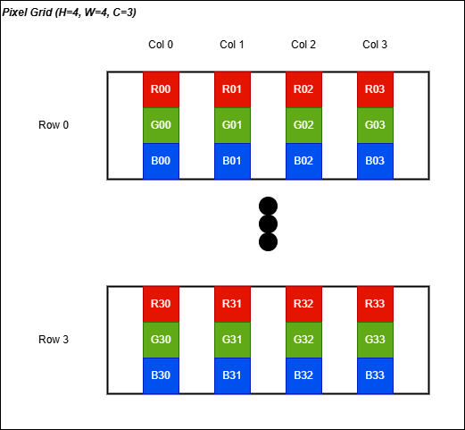
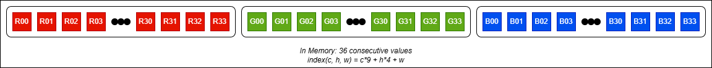
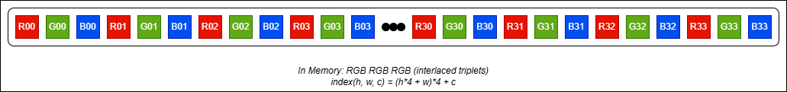

# Image Data Format Conventions: CHW vs HWC

> **Document ID:** VELA-TN-001 (Technical Note)

> **Version:** 1.0 

> **Scope:** Genreal — applicable to any CNN or image processing project 

> **Related document:** VELA-SRS-001, VELA-IVVP-001

> **Date:** 2026-05-10 

> **Author:** Gaël BOYA

--- 

## Table of contents

1. [The core question: whait is a "format"?](#1-the-core-question)
2. [Who defines the format?](#2-who-defines-the-format)
3. [CHW — Channels First](#3-chw--channels-first)
4. [HWC — Channels Last](#4-hwc--channels-last)
5. [Convention by ecosystem](#5-convention-by-ecosystem)
6. [Convention by hardware](#6-convention-by-hardware)
7. [The cost of a mismatch](#7-the-cost-of-a-mismatch)
8. [Conversion reference](#8-conversion-reference)
9. [Decision guide](#9-decision-guide)
10. [Application to VELA](#10-application-to-vela)

---

## 1. The core question

A color image has three dimensions: `height`, `width`, and `color channels` (R: *red*, G: *green*, B: *blue*).
In computer memory, data is stored as a flat sequence of bytes. The **format** defines the order in which these three dimensions are laid out in that sequence.

Given a 4x4 RGB image, two valid flat orderings exist: 
<p align="center">
    
</p>

**CHW (Channels, Height, Width) — "channels first":**

<p align="center">
    
</p>


**HWC (Height, Width, Channels) — "channels last":**

<p align="center">
    
</p>

---

## 2. Who defines the format?

No single authority mandates a global standard. The format is defined — and enforced — by four independent actors, each with their own historical reasons:

```
┌─────────────────────────────────────────────────────────────────┐
│                  Who sets the format ?                          │
│                                                                 │
│  ① Framework author    PyTorch → CHW    TensorFlow → HWC        │
│                        (NCHW)           (NHWC)                  │
│                                                                 │
│  ② Hardware vendor     GPU (NVIDIA)     FPGA / CPU              │
│                        prefers NCHW     may prefer either       │
│                                                                 │
│  ③ Dataset curator     CIFAR-10 → CHW   ImageNet → HWC (PIL)    │
│                                                                 │
│  ④ YOU                 You choose when you write your           │
│                        loader, CNN, or HLS accelerator          │
└─────────────────────────────────────────────────────────────────┘
```

The critical rule: **all components in a pipeline must agree on the same format**. A mismatch produces no error — it silently corrupts the output.

---

## 3. CHW — Channels First

### 3.1 Memory Layout

For an image of shape (C=3, H=24, W=24):

```
Index formula: element[c, h, w] = flat_array[c*(H*W) + h*W + w]

Channel plane 0 (Red)   : indices 0     to 575  (24x24 = 576 values)
Channel plane 1 (Green) : indices 576   to 1151 
Channel plane 2 (Blue)  : indices 1152  to 1727 
```

### 3.2 Access pattern

```python
# All red pixels of row 5 — Contiguous in memory
red_row5 = image[0, 5, :]   # indices 120 to 143

# All channels of pixel (5, 7) — NOT contiguous (stride = 576)
pixel_5_7 = image[:, 5, 7]  # indices 127, 703, 1279
```

### 3.3 Why GPUs prefer CHW 

A GPU convolution kernel processes one channel plane at a time. With CHW, the entire RED plane sits in a contiguous memory region — one cache fill covers the whole plane. With HWC, the GPU would need to stride through memory every 3 bytes to collect all red values, causing cache thrashing. 

NVIDIA cuDNN (the GPU math library under Pytorch and TensorFlow) operates natively in **NCHW** (Batch, Channels, Height, Width). This is why Pytorch defaults to CHW: it maps directly to cuDNN without a transpose.

### 3.4 Who uses CHW

| Framework / tool      | Default format    | Notes                             |
|:---                   |:---               |:---                               |
| PyTorch               | NCHW              | Default for all tensor operations |
| Caffe                 | NCHW              | Original deep learning framework  |
| ONNX                  | NCHW              | Standard for model exchange       |
| Vitis HLS (Xilinx)    | NCHW              | Recommended for AXI-Stream burst  |
| CIFAR-10 binary       | CHW               | Layout in the `.bin` file         |
| NumPy (convention)    | CHW               | When following PyTorch idioms     |

--- 

## 4. HWC — Channels Last

### 4.1 Memory Layout 

For an image of shape (H=24, W=24, C=3):

```
Index formula: element[h, w, c] = flat_array[h*(W*C) + w*C + c]

Pixel (0,0) : indices 0,  1,  2     (RGB)
Pixel (0,1) : indices 3,  4,  5     
Pixel (0,2) : indices 6,  7,  8     
...
Pixel (h,w) : indices (h*24 + w)*3, +1, +2
```

### 4.2 Access pattern

```python
# All channels of pixel (5, 7) — Contiguous in memory
pixel_5_7 = image[5, 7, :]  # indices 375, 376, 377

# All red pixels of row 5 — Not Contiguous in memory (stride = 3)
red_row5 = image[5, :, 0]   # indices 360, 363, 366, ...
```

### 4.3 Why CPUs and certain hardware prefer HWC

On a CPU without SIMD extensions, accessing a pixel's full RGB triplet is the most common operation (for display, blending, JPEG encoding). HWC makes the access contiguous, improving cache utilisation for pixel-wise operations.

Video display hardware is also inherently HWC: a framebuffer stores pixels left-to-right, top-to-bottom, with RGB bytes adjacent. HDMI and MIPI CSI-2 transmit pixel-by-pixel (HWC order).

### 4.4 Who uses HWC

| Framework / tool      | Default format    | Notes                             |
|:---                   |:---               |:---                               |
| TensorFlow / Keras    | NHWC              | Default on CPU and TPU            |
| OpenCV                | HWC (BGR)         | **B**GR, not RGB                  |
| PIL / Pillow          | HWC (RGB)         | Standard Python image library     |
| JPEG / PNG files      | HWC               | All standard image file formats   |
| HDMI framebuffer      | HWC               | Video display hardware            |
| MIPI CSI-2            | HWC               | Camera interface standard         |
| Android NN API        | NHWC              | Mobile inference                  |

> **OpenCV note:** OpenCV uses HWC but with **BGR** channel order, not RGB.
> This is a historical accidend from the early days of the library.
> Always convert with `cv2.cvtColor(img, cv2.COLOR_BGR2RGB)` before feeding
> an OpenCV image to a neural network trained on RGB data.

--- 

## 5. Convention by ecosystem

### 5.1 Framework comparison table
 
| Criterion         | PyTorch (CHW)     | TensorFlow (HWC)          |
|:---               |:---               |:---                       |
| Default format    | NCHW              | NHWC                      |
| GPU performance   | ✅ Native cuDNN   | ⚠️ Transposes internally |
| CPU performance   | ⚠️ Suboptimal     | ✅ Better cache use      |
| Model exchange    | ONNX (NCHW)       | TFLite (NHWC)             |
| Mobile / Edge     | Needs conversion  | ✅ Native Android/iOS     |
| Xilinx Vitis AI   | Converts to NHWC  | ✅ Native                 |

### 5.2 Dimension naming conventions
 
Different frameworks add a batch dimension N, leading to 4D tensors.
The naming conventions are:
 
```
PyTorch    : (N, C, H, W)  →  NCHW
TensorFlow : (N, H, W, C)  →  NHWC
Caffe      : (N, C, H, W)  →  NCHW
ONNX       : (N, C, H, W)  →  NCHW  (default)
 
For single-image inference (no batch dimension):
  CHW  : (C, H, W)  — PyTorch / ONNX style
  HWC  : (H, W, C)  — TensorFlow / OpenCV style
```
 
### 5.3 ONNX as an interchange format
 
ONNX (Open Neural Network Exchange) standardises on **NCHW** for vision models. When exporting from TensorFlow (NHWC) to ONNX, the exporter automatically inserts `Transpose` operations. This is transparent to the user but adds latency if not fused by the inference engine.
 
---
 
## 6. Convention by hardware
 
### 6.1 GPU (NVIDIA / AMD)
 
NVIDIA cuDNN requires NCHW for its convolution kernels when using Tensor Cores (the dedicated matrix multiplication units). PyTorch's `torch.backends.cudnn.benchmark = True` assumes NCHW tensors.
 
Since 2019, NVIDIA added NHWC support in cuDNN 7.x+ for specific layer types (Conv, BatchNorm), achieving comparable performance via internal memory reordering. TensorFlow on GPU benefits from this.
 
### 6.2 CPU (Intel / ARM)
 
Intel's oneDNN (formerly MKL-DNN) supports both formats and selects the optimal one at runtime. ARM Compute Library (used on Cortex-A and Mali GPU) prefers NHWC for better NEON SIMD utilisation.
 
### 6.3 FPGA (Xilinx Zynq / Alveo)
 
FPGAs have no intrinsic preference — the designer chooses. However, two constraints usually guide the decision:
 
**AXI-Stream burst efficiency:**  
AXI-Stream transfers data in contiguous bursts. If the convolution engine processes one channel at a time, CHW is optimal: all pixels of one channel arrive in a single burst with no gaps.
 
```
CHW burst for Conv layer (C_in channels):
  Burst 0: all pixels of channel 0  [0 .. H*W-1]      ← one DMA transfer
  Burst 1: all pixels of channel 1  [H*W .. 2*H*W-1]  ← one DMA transfer
  ...
 
HWC for the same Conv layer:
  Each pixel: 3 bytes interleaved — burst broken every 3 bytes
  → More DMA overhead, harder to pipeline
```
 
**BRAM partitioning:**  
With CHW, each channel plane can be mapped to a separate BRAM block, enabling parallel read of all channels for a single pixel position — critical for a pipelined convolution engine.
 
**Exception — display output:**  
If the FPGA drives an HDMI or SPI display directly, the output pixel stream must be HWC (the SSD1331 OLED and HDMI both expect pixel-by-pixel RGB). The conversion from CHW (internal) to HWC (output) is a simple transpose, typically done at the final stage.
 
### 6.4 NPU / dedicated accelerators
 
| Accelerator           | Format    | Notes                                 |
|:---                   |:---       |:---                                   |
| Google TPU            | NHWC      | Systolic array favours HWC            |
| Apple Neural Engine   | NHWC      | Core ML default                       |
| Hailo-8               | NHWC      | Compiler handles conversion           |
| Xilinx DPU            | NHWC      | Vitis AI converts from PyTorch NCHW   |
| ARM Ethos-N           | NHWC      | Arm NN framework                      |
 
> **Observation:** dedicated NPUs tend to prefer NHWC because they are optimised for pixel-wise throughput (mobile, embedded use cases), while general-purpose GPU computation favours NCHW.
 
---
 
## 7. The cost of a mismatch
 
A format mismatch produces **no runtime error**. The computation succeeds, but the output is wrong. This makes it one of the most dangerous bugs in a CNN pipeline.
 
### 7.1 What happens concretely
 
Suppose weights were learned with HWC reshape before the FC layer, but the inference code uses CHW reshape:
 
```
Correct (HWC):  [R(0,0), G(0,0), B(0,0), R(0,1), G(0,1), B(0,1), ...]
Incorrect (CHW):[R(0,0), R(0,1), R(0,2), ..., R(3,3), G(0,0), G(0,1), ...]
```
 
The FC weight matrix `W` has shape (10, 180). Each row of W was trained to multiply against a specific arrangement of the 180 values. With the wrong arrangement, every dot product is computed against the wrong values.
 
**Effect on accuracy:** the network outputs approximately uniform probabilities (~10% per class), regardless of the input image. It appears to "work" in the sense that it returns a valid probability distribution — it just always predicts the same class or predicts randomly.
 
### 7.2 Diagnostic checklist
 
If accuracy is stuck at ~10% on CIFAR-10 (10 classes):
 
```
Step 1 : Check reshape order before FC
         Python: fmap.transpose(1,2,0).flatten() vs fmap.flatten()
 
Step 2 : Check channel order at loading
         CIFAR-10 is RGB — verify your loader matches the training order
 
Step 3 : Check normalisation scope
         Global (all channels together) vs per-channel — must match training
 
Step 4 : Verify weight file corresponds to the architecture
         CNN_coeff_3x3.txt ↔ 3×3 kernels, CNN_coeff_5x5.txt ↔ 5×5 kernels
 
Step 5 : Run test_VELAFR005 on 10 images with verbose mode
         At least 2 distinct classes should be predicted
```
 
---
 
## 8. Conversion reference
 
### 8.1 Python / NumPy
 
```python
import numpy as np
 
# CHW → HWC
# (C, H, W) → (H, W, C)
hwc = chw.transpose(1, 2, 0)
 
# HWC → CHW
# (H, W, C) → (C, H, W)
chw = hwc.transpose(2, 0, 1)
 
# With batch dimension
# NCHW → NHWC
nhwc = nchw.transpose(0, 2, 3, 1)
 
# NHWC → NCHW
nchw = nhwc.transpose(0, 3, 1, 2)
```
 
### 8.2 PyTorch
 
```python
import torch
 
# CHW → HWC  (for display or OpenCV)
hwc = chw_tensor.permute(1, 2, 0).numpy()
 
# HWC → CHW  (from PIL/OpenCV to PyTorch)
chw = torch.from_numpy(hwc).permute(2, 0, 1)
 
# Efficient memory-contiguous version
chw = torch.from_numpy(hwc).permute(2, 0, 1).contiguous()
```
 
### 8.3 C / C++ (manual index calculation)
 
```c
// CHW layout: index(c, h, w) = c*(H*W) + h*W + w
float get_chw(float* img, int c, int h, int w, int H, int W) {
    return img[c * (H * W) + h * W + w];
}
 
// HWC layout: index(h, w, c) = (h*W + w)*C + c
float get_hwc(float* img, int h, int w, int c, int W, int C) {
    return img[(h * W + w) * C + c];
}
 
// CHW → HWC conversion
void chw_to_hwc(float* chw, float* hwc, int C, int H, int W) {
    for (int c = 0; c < C; c++)
        for (int h = 0; h < H; h++)
            for (int w = 0; w < W; w++)
                hwc[(h * W + w) * C + c] = chw[c * (H * W) + h * W + w];
}
```
 
### 8.4 Verilog / FPGA (AXI-Stream)
 
In a streaming pipeline, the format determines the order in which pixels arrive on the AXI-Stream bus:
 
```verilog
// CHW streaming: all pixels of channel 0, then channel 1, then channel 2
// Suitable for: convolution engines that process one channel plane at a time
//
// Pixel counter:  0      1      2  ...  575   576   577  ... 1151  1152 ...
// Channel:        R      R      R        R     G     G         G    B    ...
// Position (h,w): (0,0) (0,1) (0,2)...(23,23)(0,0)(0,1)...(23,23)(0,0)...
 
// HWC streaming: R,G,B of pixel(0,0), then R,G,B of pixel(0,1), etc.
// Suitable for: display drivers, JPEG encoders, MIPI CSI-2 output
//
// Pixel counter:  0  1  2   3  4  5   6  7  8  ...
// Channel:        R  G  B   R  G  B   R  G  B  ...
// Position (h,w): (0,0)    (0,1)    (0,2)  ...
```
 
---
 
## 9. Decision guide
 
Use this flowchart to choose the format for a new component:
 
```
Are you writing a new module in an existing pipeline?
  YES → Match the format of the modules it connects to.
        Do not introduce a mismatch.
  NO  → You are starting a new pipeline. Choose based on:
 
        Primary computation target?
        ├── GPU (PyTorch training)    → CHW  (NCHW)
        ├── CPU / mobile inference   → HWC  (NHWC)
        ├── FPGA convolution engine  → CHW  (burst DMA efficiency)
        ├── FPGA display output      → HWC  (pixel-by-pixel for HDMI/SPI)
        └── Mixed FPGA pipeline      → CHW internally, convert at output
 
        Are you loading a pre-trained model?
        ├── PyTorch / ONNX weights   → CHW  (mandatory)
        ├── TensorFlow / Keras weights → HWC (mandatory)
        └── Custom weights (like VELA CNN_coeff_3x3.txt)
              → Check training code format → match it exactly
```
 
### The golden rule
 
> **The format is defined by whoever trained the weights.**  
> Everything else — loaders, preprocessors, HLS accelerators, display drivers — must adapt to that format, or explicitly convert at well-defined boundaries.
 
---
 
## 10. Application to VELA
 
### 10.1 Format choices in the VELA pipeline
 
| Stage             | Component                         | Format        | Reason                    |
|:---               |:---                               |:---           |:---                       |
| File loading      | `load_batch()`                    | CHW           | CIFAR-10 binary layout    |
| Preprocessing     | `crop_center()`, `normalize()`    | CHW           | Preserves layout          |
| CNN layers        | `conv2d`, `relu`, `maxpool2d`     | CHW           | Consistent throughout     |
| FC reshape        | `transpose(1,2,0).flatten()`      | HWC flatten   | Must match training       |
| HLS accelerator   | `cnn_top()` input                 | CHW           | AXI burst efficiency      |
| BRAM storage      | image buffer                      | CHW           | Channel-parallel read     |
| OLED output       | `result_display.v`                | HWC           | SSD1331 pixel-by-pixel    |
| UART debug        | JSON output                       | N/A           | Values only, no layout    |
 
### 10.2 The one conversion point
 
There is exactly **one** format conversion in the VELA pipeline:
 
```
CHW (internal CNN) ──► HWC flatten ──► FC layer ──► Softmax ──► class
                   ↑
             This transpose is the only CHW→HWC conversion.
             It is defined by the training code.
             It is verified by test_VELAFR004.
 
CHW (BRAM)  ──► result_display.v ──► SPI ──► OLED
           ↑
     Second conversion point: CHW→HWC for display output.
     Done in result_display.v, not in the CNN accelerator.
```
 
### 10.3 Boundary documentation in code
 
Every module that handles image data must declare its expected format in its docstring or header comment:
 
```python
def conv2d_fast(input_fmap, weights, biases, padding="same"):
    """
    2D convolution — expects CHW input format.
 
    Args:
        input_fmap : np.ndarray (C_in, H, W)  — CHW format
        weights    : np.ndarray (C_out, C_in, kH, kW)
        biases     : np.ndarray (C_out,)
    Returns:
        np.ndarray (C_out, H_out, W_out)       — CHW format
    # REQ: VELA-FR-001
    """
```
 
```verilog
// cnn_accelerator.v
// Input  : AXI-Stream, CHW order, 8-bit fixed-point
// Output : AXI-Lite register, class index [3:0] + confidence [7:0]
// REQ: VELA-FR-020, VELA-FR-022
```
 
---
 
## References
 
- NVIDIA cuDNN Developer Guide — Data Layout Formats  
  https://docs.nvidia.com/deeplearning/cudnn/developer/graph-api.html
- PyTorch documentation — Memory format  
  https://pytorch.org/docs/stable/tensor_attributes.html#torch.memory_format
- ONNX Operator Specification — Conv  
  https://onnx.ai/onnx/operators/onnx__Conv.html
- Xilinx Vitis AI User Guide UG1414 — Data Quantization and Formats  
- CIFAR-10 dataset technical report — Krizhevsky, 2009  
  https://www.cs.toronto.edu/~kriz/cifar.html
- ARM Compute Library — Tensor Formats  
  https://arm-software.github.io/ComputeLibrary/latest/
---
 
*End of document — VELA-TN-001 v1.0*
 