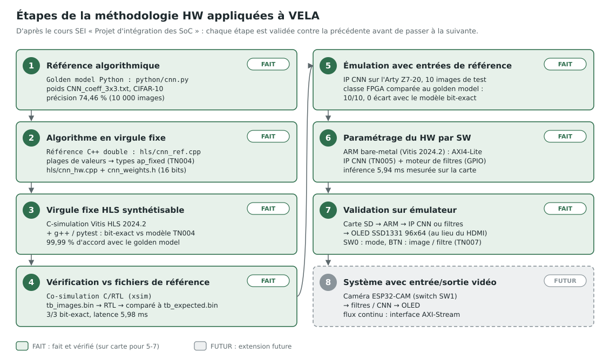
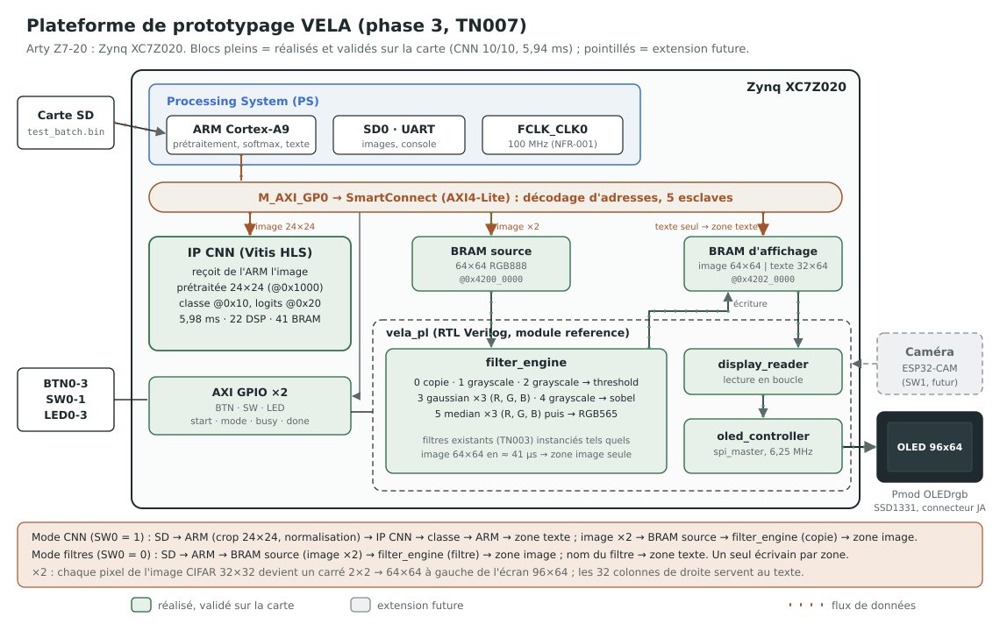
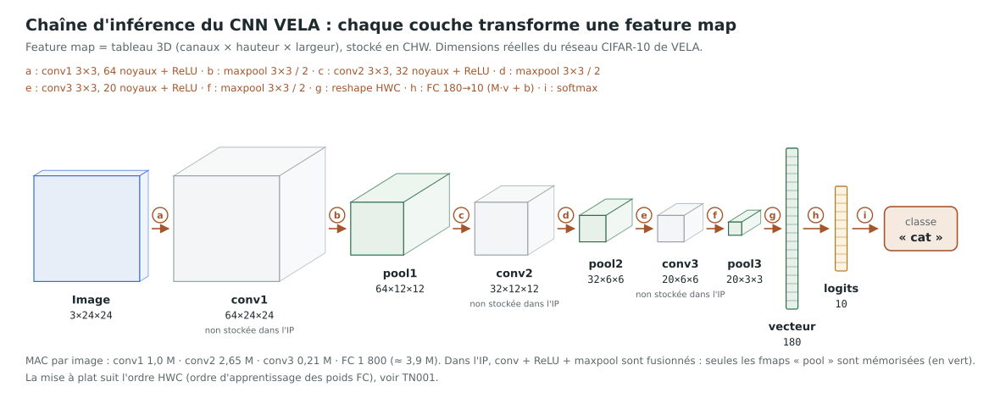
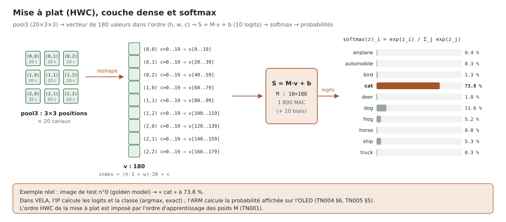

# Guide visuel : méthodologie HW, plateforme et chaîne d'inférence

> **Document ID:** VELA-TN-006 (Technical Note)

> **Version:** 1.0

> **Scope:** Vue d'ensemble illustrée du projet VELA : démarche de conception matérielle, plateforme de prototypage visée, et fonctionnement du CNN couche par couche

> **Related documents:** VELA-TN-001 (formats CHW / HWC), VELA-TN-002 (vérification), VELA-TN-004 (virgule fixe), VELA-TN-005 (IP CNN)

> **Date:** 2026-11-01

> **Author:** Gaël BOYA

---

## Sommaire

1. [Objet](#1-objet)
2. [Étapes de la méthodologie HW](#2-étapes-de-la-méthodologie-hw)
3. [Plateforme de prototypage](#3-plateforme-de-prototypage)
4. [Chaîne d'inférence du CNN](#4-chaîne-dinférence-du-cnn)
5. [Convolution multi-canal](#5-convolution-multi-canal)
6. [MaxPool 3×3, pas 2, padding SAME](#6-maxpool-33-pas-2-padding-same)
7. [Mise à plat, couche dense et softmax](#7-mise-à-plat-couche-dense-et-softmax)
8. [Régénérer les schémas](#8-régénérer-les-schémas)

---

## 1. Objet

Les schémas de cette note illustrent trois aspects du projet : les *étapes
de la méthodologie HW*, la *plateforme de prototypage* et les *structures de
données d'un CNN*. Ils décrivent **l'implémentation actuelle de VELA** :
dimensions réelles du réseau, fichiers et outils du dépôt, état
d'avancement de chaque étape.

Les schémas animés tournent en boucle dans un navigateur et sur GitHub ;
avec l'option système « réduire les animations », ils restent figés et
complets.

---

## 2. Étapes de la méthodologie HW

<p align="center">
    
</p>

Chaque étape est validée **contre la précédente** avant de passer à la
suivante : c'est ce qui permet de localiser une erreur à une seule étape.

| # | Étape | Dans VELA | État |
| :---: | :--- | :--- | :--- |
| 1 | Référence algorithmique | golden model Python (`python/cnn.py`) | fait |
| 2 | Algorithme en virgule fixe | référence C++ `double`, plages de valeurs, `ap_fixed` 16 bits (TN004) | fait |
| 3 | Virgule fixe HLS synthétisable | C-simulation Vitis HLS, bit-exact vs modèle TN004 | fait |
| 4 | Vérification vs fichiers de référence | co-simulation C/RTL : 3/3 bit-exact, 5,98 ms (TN005) | fait |
| 5 | Émulation avec entrées de référence | 10 images de test sur la carte : 10/10 comme le golden model, 0 écart avec le modèle bit-exact (TN007 §10.4) | fait (carte) |
| 6 | Paramétrage du HW par SW | application bare-metal : l'ARM pilote l'IP CNN en AXI4-Lite et le moteur de filtres en GPIO ; inférence 5,94 ms | fait (carte) |
| 7 | Validation sur émulateur | carte SD → ARM → IP CNN ou filtres → OLED, modes et boutons | fait (carte) |
| 8 | Système avec entrée/sortie vidéo | caméra ESP32-CAM (switch SW1) | futur |

Dans VELA, la sortie d'image est l'écran **Pmod OLED 96×64** (SSD1331), et
l'entrée de référence vient de la **carte SD** (jeu de test CIFAR-10).

---

## 3. Plateforme de prototypage

<p align="center">
    
</p>

Éléments de la plateforme sur la carte Arty Z7-20 :

- **ARM (PS)** : lit les images sur la carte SD, les prétraite (recadrage,
  normalisation), pilote l'IP CNN et écrit le texte du résultat.
- **Bus AXI4-Lite** : un seul port (GP0) vers les IP de la logique
  programmable, à 100 MHz (`FCLK_CLK0`).
- **IP CNN** : l'accélérateur HLS (TN005), déjà validé.
- **Mémoires** : BRAM source (64×64 RGB888) et BRAM d'affichage (96×64
  RGB565), partagées entre l'ARM et la logique programmable ; un seul
  écrivain par zone de l'affichage (TN007 §5.1).
- **`vela_pl`** : `filter_engine` (filtres RTL de la phase 2a, gaussian et
  median en couleur), `display_reader` et `oled_controller` / `spi_master`
  vers l'écran OLED.

Tous les blocs sont réalisés et validés sur la carte (TN007 §10.4) ; seule la
caméra, en pointillés, reste une extension future. Les flux animés montrent le
chemin du CNN (cuivre) et celui des filtres et de l'affichage (vert).

---

## 4. Chaîne d'inférence du CNN

<p align="center">
    
</p>

**Chaque couche prend une feature map et en produit une**. Une feature map est un tableau 3D (canaux × hauteur × largeur), rangé
en mémoire dans l'ordre CHW (TN001).

| Feature map | Dimensions | Valeurs | Produite par |
| :--- | :--- | ---: | :--- |
| image | 3 × 24 × 24 | 1 728 | prétraitement (ARM) |
| conv1 | 64 × 24 × 24 | 36 864 | convolution 3×3, 64 noyaux, + ReLU |
| pool1 | 64 × 12 × 12 | 9 216 | maxpool 3×3, pas 2 |
| conv2 | 32 × 12 × 12 | 4 608 | convolution 3×3, 32 noyaux, + ReLU |
| pool2 | 32 × 6 × 6 | 1 152 | maxpool 3×3, pas 2 |
| conv3 | 20 × 6 × 6 | 720 | convolution 3×3, 20 noyaux, + ReLU |
| pool3 | 20 × 3 × 3 | 180 | maxpool 3×3, pas 2 |
| vecteur | 180 | 180 | mise à plat dans l'ordre HWC |
| logits | 10 | 10 | couche dense 180 → 10 |

Dans l'IP, convolution, ReLU et maxpool sont **fusionnés** : les feature maps
« conv » ne sont jamais stockées, seules les « pool » occupent de la mémoire.

---

## 5. Convolution multi-canal

<p align="center">
    
</p>

`S[c, i, j] = Σ_l Σ_m Σ_n I[l, i+m−1, j+n−1] · K[c, l, m, n] + bias[c]`

- Une sortie combine les **3×3 voisins de tous les canaux d'entrée** : un
  noyau `K_c` a autant de tranches 3×3 que l'entrée a de canaux.
- Chaque noyau produit **un canal de sortie** : 64 noyaux pour conv1.
- Bords : padding « same », les voisins hors image valent 0, la sortie a la
  même taille que l'entrée.
- Dans l'IP : **8 noyaux en parallèle**, chaque valeur d'entrée lue une fois
  alimente 8 multiplications (8 DSP) ; accumulateur exact `ap_fixed<40,14>`.

---

## 6. MaxPool 3×3, pas 2, padding SAME

<p align="center">
    
</p>

- Chaque sortie est le **maximum** d'une fenêtre 3×3 ; avec un pas de 2, les
  fenêtres **se recouvrent** d'une ligne et d'une colonne.
- Padding « SAME » de TensorFlow : sortie de taille `ceil(n / 2)` ; la ligne
  et la colonne manquantes sont ajoutées **en bas et à droite** et ne sont
  jamais retenues (−∞). C'est le comportement du golden model.
- Dans l'IP, une sortie de convolution appartient à 1, 2 ou 4 fenêtres : elle
  met directement à jour ces cases (TN005 §2).

---

## 7. Mise à plat, couche dense et softmax

<p align="center">
    
</p>

- **Mise à plat** : les 20 × 3 × 3 valeurs de pool3 deviennent un vecteur de
  180, dans l'ordre **HWC** (`index = (h·3 + w)·20 + c`), l'ordre dans lequel
  les poids de la couche dense ont été appris (TN001).
- **Couche dense** : produit matrice-vecteur `S = M·v + b`, M de taille
  10 × 180 (1 800 multiplications).
- **Softmax** : `exp(z_i) / Σ exp(z_j)` transforme les 10 logits en
  probabilités. Les probabilités du schéma sont réelles : image de test n°0,
  « cat » à 73,8 % avec le golden model.
- Dans VELA, l'IP fournit les logits et la classe (argmax) ; la probabilité
  affichée sur l'OLED est calculée par l'ARM.

---

## 8. Régénérer les schémas

Tous les schémas de `docs/diagrams/` sont produits par un script, sans outil
de dessin :

```bash
make diagrams      # python tools/gen_diagrams.py → docs/diagrams/*.svg
```

`verif/tests/test_diagrams.py` vérifie que chaque SVG est du XML valide et
que les fichiers du dépôt sont à jour par rapport au script.
