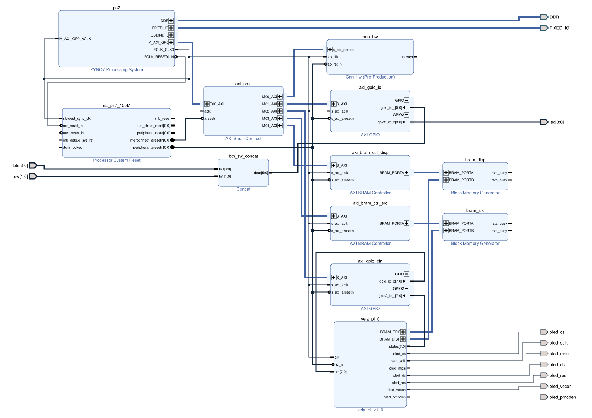

# FPGA Integration: Architecture and Specification (Phase 3)

> **Document ID:** VELA-TN-007 (Technical Note)

> **Version:** 1.0 (approved 2026-11-02)

> **Scope:** VELA Phase 3 — integration of the CNN IP, the RTL filters and the OLED display path with the Zynq PS on the Arty Z7-20

> **Related documents:** VELA-SRS-001 (`docs/requirement/requirements.md`), VELA-TN-003 (RTL filters, display path), VELA-TN-005 (CNN IP), VELA-TN-006 (visual guide)

> **Date:** 2026-11-01

> **Author:** Gaël BOYA

---

## Table of contents

1. [Purpose](#1-purpose)
2. [System architecture](#2-system-architecture)
3. [Processing system configuration](#3-processing-system-configuration)
4. [Address map](#4-address-map)
5. [Memories](#5-memories)
6. [New RTL modules](#6-new-rtl-modules)
7. [GPIO assignment](#7-gpio-assignment)
8. [Pins](#8-pins)
9. [Software (ARM, bare-metal)](#9-software-arm-bare-metal)
10. [Verification plan](#10-verification-plan)
11. [Proposed requirements](#11-proposed-requirements)
12. [Schematics](#12-schematics)
13. [Design decisions](#13-design-decisions)

---

## 1. Purpose

This note specifies the complete FPGA system of Phase 3: the Vivado block
design (Zynq PS, AXI interconnect, CNN IP, memories, GPIO), the new RTL
modules that connect the existing filters and display path, the pin
constraints, and the bare-metal application running on the ARM.

Everything up to the bitstream and the compiled application is verifiable
without the board; the on-board validation (§10.4) needs the Arty Z7-20.

---

## 2. System architecture

```
                 ┌────────────────────────── Zynq PS (ARM Cortex-A9) ──────────────────────────┐
  SD card ─────► │ SD0: test_batch.bin     UART0: console (USB)     FCLK_CLK0 = 100 MHz        │
                 └───────────────────────────────┬─────────────────────────────────────────────┘
                                                 │ M_AXI_GP0 (AXI4-Lite through SmartConnect)
        ┌──────────────────┬─────────────────────┼────────────────────┬──────────────────────┐
        ▼                  ▼                     ▼                    ▼                      ▼
   cnn_hw (HLS)      axi_gpio_io            axi_gpio_ctrl        axi_bram_ctrl_src      axi_bram_ctrl_disp
   TN005             BTN/SW in, LED out     filter control        │ port A                 │ port A
                                            │                     ▼                        ▼
                                            │               ┌──────────┐             ┌──────────┐
                                            │               │ src BRAM │             │ disp BRAM│
                                            │               │ 64x64    │             │ 96x64    │
                                            │               │ RGB888   │             │ RGB565   │
                                            │               └────┬─────┘             └────┬─────┘
                                            │                    │ port B (read)          │ port B (write / read)
                                            ▼                    ▼                        │
                              ┌──────────────────────────── vela_pl (RTL, module reference) ──────────────┐
                              │  filter_engine: src → copy | grayscale [→ threshold | sobel] |            │
                              │                 gaussian ×3 | median ×3 (R, G, B) → RGB565 → disp ────────┤
                              │  display_reader: disp → AXI-Stream → oled_controller → spi_master  (reads)│
                              └──────────────────────────────────────────────────────────┬────────────────┘
                                                                                         ▼
                                                                          Pmod OLEDrgb on JA (SSD1331)
```

Two modes, selected by switch SW0 and run by the ARM:

| Mode | Data path |
| :--- | :--- |
| **CNN** (SW0 = 1) | SD → ARM (crop 24×24, normalize, raw codes) → `cnn_hw` → class + logits → ARM writes the text « CAT 74% » into the text zone. The image is shown through the engine: ARM writes it (×2) into the source BRAM, `filter_engine` in mode 0 (copy) → image zone |
| **Filters** (SW0 = 0) | SD → ARM writes the image (×2) into the source BRAM → `filter_engine` (filter chosen by BTN2/BTN3) → image zone; ARM writes the filter name into the text zone |

**One writer per display zone** (§5.1): the image zone is written only by
`vela_pl`, the text zone only by the ARM, in both modes.

In both modes `display_reader` sends the display BRAM to the OLED
continuously (≈ 60 frames/s), independently of the ARM and of the engine.

**The CNN IP does not read the source BRAM.** The ARM writes the image into
the IP's own AXI4-Lite image window (`0x1000`, TN005 §4), because the CNN
input is not the raw image:

| | Source BRAM (filters) | CNN IP image window |
| :--- | :--- | :--- |
| Size | 64 × 64 (CIFAR image ×2) | 24 × 24 (center crop) |
| Values | raw RGB888 pixels, 0..255 | per-image normalized values (x − mean) / std |
| Format | 1 pixel per 32-bit word | `input_t` 16-bit raw codes, 2 per word, CHW |

The normalization (mean, standard deviation: square root, division) is done
by the ARM in `float`, exactly as `python/data_loader.py`, so that the CNN
input is identical to the golden model's (Phase 2b option A, all AXI4-Lite).
Writing the 864 words takes a few tens of µs (estimate, to be measured on the
board), against 6 ms of inference.

**Image ×2.** A CIFAR-10 image is 32 × 32 pixels, the OLED 96 × 64: each
pixel is duplicated into a 2 × 2 square, so the image fills 64 × 64 pixels on
the left of the screen; the 32 columns on the right hold the text (class,
probability). A ×3 scale (96 × 96) does not fit the 64 rows.

---

## 3. Processing system configuration

- `processing_system7` with the **Arty Z7-20 board preset**
  (`digilentinc.com:arty-z7-20:part0:1.1`, installed in the Vivado board
  store): DDR, MIO, SD0, UART0 (USB-UART bridge), USB.
- **FCLK_CLK0 = 100 MHz**: the only PL clock (VELA-NFR-001), for every IP,
  memory port and RTL module.
- **M_AXI_GP0** enabled, 32-bit, through one **SmartConnect** (1 slave,
  5 masters). No high-performance port, no interrupt (the ARM polls).
- Reset: `proc_sys_reset` driven by `FCLK_RESET0_N`; its
  `peripheral_aresetn` resets the AXI IPs and `vela_pl` (`rst_n`, synchronous
  active low, as in all VELA RTL).

---

## 4. Address map

| Slave | Base | Range | Content |
| :--- | :--- | :--- | :--- |
| `cnn_hw` (s_axi_control) | `0x4000_0000` | 64 KB | TN005 §4 (image at +`0x1000`, class at +`0x10`) |
| `axi_gpio_io` | `0x4120_0000` | 64 KB | buttons, switches, LEDs (§7) |
| `axi_gpio_ctrl` | `0x4121_0000` | 64 KB | filter engine control and status (§7) |
| `axi_bram_ctrl_src` | `0x4200_0000` | 16 KB | source image (§5) |
| `axi_bram_ctrl_disp` | `0x4202_0000` | 32 KB | display image (§5) |

The addresses are set explicitly by the block design script and exported in
`xparameters.h` through the XSA.

---

## 5. Memories

Both are Block Memory Generator instances in **true dual port** mode,
32-bit words, port A on an AXI BRAM controller (ARM), port B on `vela_pl`.

| Memory | Size | Word | Content |
| :--- | :--- | :--- | :--- |
| source | 4 096 words (16 KB, 4 BRAM 36 Kb) | `n = y × 64 + x`, 0..4095 | `0x00RRGGBB` (RGB888), written by the ARM, read by `filter_engine` |
| display | 8 192 words (32 KB, 8 BRAM 36 Kb), 6 144 used | `n = y × 96 + x`, 0..6143 | `0x0000` + RGB565 (`R[4:0] G[5:0] B[4:0]`), read by `display_reader` |

- Port B uses the BRAM controller conventions: **byte address**
  (`addr = n × 4`), 4 write-enable bits, **read latency 1 cycle** (primitive
  output register disabled), clock FCLK_CLK0.
- Display words 6144..8191 are unused.
- Display port B is shared: `filter_engine` has priority while it runs
  (≈ 41 µs); `display_reader` waits. Since `display_reader` needs one word
  every ≈ 2.7 µs (SPI), the OLED does not see the pause.

Total: 12 BRAM 36 Kb, added to the 41 of `cnn_hw` → 53 / 140 (38 %).

### 5.1 Display zones: one writer each

```
          x = 0                 63 64          95
   y = 0  ┌──────────────────────┬──────────────┐
          │      IMAGE ZONE      │  TEXT ZONE   │
          │   64 × 64, written   │ 32 × 64,     │
          │   only by vela_pl    │ written only │
          │   (filter_engine,    │ by the ARM   │
          │    port B)           │ (port A)     │
   y = 63 └──────────────────────┴──────────────┘
```

| Zone | Columns | Words | Only writer | Guarantee |
| :--- | :---: | :--- | :--- | :--- |
| image | 0..63 | `y × 96 + x`, `x < 64` | `filter_engine` (port B) | by construction: the engine address generator only produces `x < 64` (tested, §10.1) |
| text | 64..95 | `y × 96 + x`, `x ≥ 64` | ARM (port A) | software: the text drawing function clips to `x ≥ 64` (tested on the host, §10.2) |

Why it matters:

- **No overwriting.** The image and the text never erase each other,
  whatever the order of the ARM writes and of the engine runs (e.g. the
  ARM may write the class text while the engine copies the image).
- **No write collision.** A true dual-port BRAM gives an undefined result
  when both ports write the **same address** in the same cycle; with
  disjoint zones, ports A and B never write the same word.
- **Read during write.** `display_reader` (port B) reads the text zone
  while the ARM (port A) may write it. Port A is configured in
  **READ_FIRST** mode (common clock): the reader then gets the old or the
  new value, never a corrupted one. At worst one pixel is one frame late
  (16.7 ms).

---

## 6. New RTL modules

Verilog-2001, same conventions as the existing RTL (VELA-NFR-005, TN003 §2):
`clk`, `rst_n` synchronous active low, no Xilinx primitive. The BRAM ports
carry `X_INTERFACE_INFO` attributes so that Vivado connects them as
`BRAM_PORT` interfaces (attributes only, ignored by the simulators).

### 6.1 `vela_pl` (top of the PL logic)

Instantiates `filter_engine`, `display_reader`, `oled_controller`
(→ `spi_master`) and the display port B multiplexer. Added to the block
design as a **module reference**.

| Port | Dir | Width | Description |
| :--- | :--- | :---: | :--- |
| `clk`, `rst_n` | in | 1 | FCLK_CLK0, `peripheral_aresetn` |
| `ctrl` | in | 8 | from `axi_gpio_ctrl` ch1 (§7) |
| `status` | out | 8 | to `axi_gpio_ctrl` ch2 (§7) |
| `src_addr`, `src_en`, `src_dout` (+ `src_clk`, `src_we`, `src_din`, `src_rst`) | | | source BRAM port B (read only) |
| `disp_addr`, `disp_en`, `disp_we`, `disp_din`, `disp_dout` (+ `disp_clk`, `disp_rst`) | | | display BRAM port B |
| `oled_cs`, `oled_sclk`, `oled_mosi`, `oled_dc`, `oled_res`, `oled_vccen`, `oled_pmoden` | out | 1 | Pmod JA; `oled_cs` tied to 0 |

### 6.2 `filter_engine`

Processes one 64 × 64 frame from the source memory to the **image zone** of
the display memory (§5.1).

| Item | Specification |
| :--- | :--- |
| Start | rising edge of `start` (ctrl bit 0) while idle; `mode` is sampled at that edge |
| Modes and paths | see the table below; 6-7 = copy |
| Filter parameters | existing modules unchanged, instantiated with `IMG_WIDTH = 64`, `IMG_HEIGHT = 64`, `THRESHOLD = 128`, `MAG_SHIFT = 2` |
| Output colour | colour result (R, G, B): `{R[7:3], G[7:2], B[7:3]}`; grey result Y: `{Y[7:3], Y[7:2], Y[7:3]}` |
| Reading | source addresses 0..4095 in raster order, one per cycle, read latency 1; the word read is registered once before the filters (timing of the complete design, §12.3) |
| Writing | the `k`-th result (`valid_out`, `k` = 0..4095) is written at display address `(k / 64) × 96 + (k mod 64)`; never in the text zone; no back-pressure is needed: the memory accepts one word per cycle |
| End | `busy` falls and `done` rises after the 4 096th write; `done` stays set until the next start |
| Duration | 4 096 cycles + pipeline latency (≤ `IMG_WIDTH` + 9): ≈ 41 µs |

| Mode | Path | Output | Python model (`python/filters.py`) |
| :---: | :--- | :--- | :--- |
| 0 | copy | colour | — |
| 1 | `grayscale` | grey | `grayscale` |
| 2 | `grayscale` → `threshold` | grey (0 / 255) | `threshold` on the grey image |
| 3 | `gaussian` × 3, one instance per channel R, G, B | colour | `gaussian`, applied to each channel |
| 4 | `grayscale` → `sobel_filter` | grey | `sobel` (converts to grey itself) |
| 5 | `median_filter` × 3, one instance per channel R, G, B | colour | `median`, applied to each channel |

Sobel and threshold work on the luminance by nature; gaussian and median are
per-channel in the golden model, so the engine keeps the colour: the three
instances receive the same `valid_in` and run in lockstep (same latency, same
`ready_in`), only the outputs of channel R drive the write control.

The 3x3 filters drop `ready_in` only during their end-of-frame flush, i.e.
after the last source pixel (TN003 §6.4): the engine reads one frame per
start, so the source never has to stop (TN003 §11 concern does not apply).

### 6.3 `display_reader`

Streams the display memory to `oled_controller` over AXI-Stream.

- Reads addresses 0, 1, …, 6143, 0, 1, … for ever; one-word buffer;
  `tvalid` held until `tready` (AXI-Stream rule), so no pixel is lost.
- Starts at address 0 when `oled_controller` first raises `tready`, which
  matches the SSD1331 RAM pointer reset by the init sequence (column
  0..95, row 0..63, wrap-around): pixel `n` always lands at `(n mod 96, n / 96)`.
- Waits while `filter_engine` owns the port (`grant = 0`).
- Frame time: 6 144 pixels × 2 bytes × 17 half periods of 8 cycles ≈ 16.7 ms.

### 6.4 Display port multiplexer (in `vela_pl`)

`filter_engine` busy → it drives port B (write); otherwise `display_reader`
drives it (read). Combinational multiplexer on `addr`/`en`/`we`/`din`;
`grant` to `display_reader` = not busy.

---

## 7. GPIO assignment

| IP / channel | Dir | Bits | Use |
| :--- | :--- | :---: | :--- |
| `axi_gpio_io` ch1 | in | 6 | `[3:0]` BTN3..BTN0, `[5:4]` SW1..SW0 (board interfaces `btns_4bits`, `sws_2bits` concatenated) |
| `axi_gpio_io` ch2 | out | 4 | LD3..LD0 |
| `axi_gpio_ctrl` ch1 | out | 8 | `[0]` start, `[3:1]` mode, `[7:4]` reserved (0) |
| `axi_gpio_ctrl` ch2 | in | 8 | `[0]` busy, `[1]` done, `[7:2]` 0 |

Buttons and switches are sampled and **debounced by the software** (10 ms
period). The mode state machine is in the software too (§13).

---

## 8. Pins

Board interfaces (buttons, switches, LEDs, PS MIO/DDR) come from the board
file. The OLED pins, verified on this board by the earlier Sobel project:

| Signal | Pmod pin | FPGA pin | IOSTANDARD |
| :--- | :---: | :---: | :---: |
| `oled_cs` (always 0) | JA1 | Y18 | LVCMOS33 |
| `oled_mosi` | JA2 | Y19 | LVCMOS33 |
| `oled_sclk` | JA4 | Y17 | LVCMOS33 |
| `oled_dc` | JA7 | U18 | LVCMOS33 |
| `oled_res` | JA8 | U19 | LVCMOS33 |
| `oled_vccen` | JA9 | W18 | LVCMOS33 |
| `oled_pmoden` | JA10 | W19 | LVCMOS33 |

`constraints/vela_arty_z7_20.xdc`; the OLED outputs are slow (6.25 MHz) and
get `set_false_path -to` (no output delay constraint is meaningful).

---

## 9. Software (ARM, bare-metal)

Vitis 2024.2, standalone BSP, from the XSA exported by Vivado. Sources in
`sw/vela_app/`.

| Function | Specification |
| :--- | :--- |
| SD card | FatFs (`xilffs`), file `test_batch.bin` (CIFAR-10 binary: 10 000 × [1 label byte + 3 072 bytes R, G, B planes 32×32]) |
| Preprocessing | center crop 24×24, per-image mean / standard deviation in `float`, identical to `python/data_loader.py`; raw codes and packing identical to `input_raw()` / `pack_image_words()` (TN005 §5) |
| CNN driver | TN005 §5 sequence; latency measured with the global timer |
| Probability | softmax of the 10 logits (`expf`) |
| Display (CNN) | 32×32 image ×2 written into the source BRAM, engine started in mode 0 (copy), `done` polled; class name and probability drawn in the text zone (5×7 font) |
| Display (filters) | 32×32 image ×2 written into the source BRAM, engine started in the selected mode, `done` polled; filter name drawn in the text zone |
| Text zone | the only display BRAM area the software writes: drawing functions clip to columns 64..95 (§5.1) |
| Controls | SW0 = mode (1 CNN, 0 filters); BTN0 / BTN1 = previous / next image; BTN2 / BTN3 = previous / next filter; LD3..LD0 = class (CNN) or filter number (filters) |
| Console (UART, 115 200 Bd) | per image: index, label, class, probability, latency |
| Validation mode | at start-up: the first 10 test images, FPGA class compared to the golden-model class (table generated by a script from the Python model, `sw/vela_app/golden_ref.h`), summary « N / 10 » on the console |

---

## 10. Verification plan

### 10.1 RTL (same method as Phase 2a, TN002)

| Test | Checks |
| :--- | :--- |
| `filter_engine` | each mode on CIFAR-10 images ×2 (64×64): image zone bit-exact vs the Python integer models; each image-zone word written once, **no write in the text zone** (pre-filled pattern unchanged); `busy`/`done`; restart; duration |
| `display_reader` | address order, wrap-around, no pixel lost or duplicated under random `tready`, waits when `grant = 0` |
| `vela_pl` | engine run while the reader streams to a short-delay `oled_controller`: the SPI bytes after init are the display memory, in order, frame after frame |

Lint and out-of-context synthesis of the new modules (`make rtl-lint`,
`make synth`), as for the filters.

### 10.2 Software on the host

`verif/tests/test_sw_host.py` compiles the portable C code with `gcc`
(`-Wall -Wextra -Werror -pedantic`) and compares it with the Python reference:

| Check | Result |
| :--- | :--- |
| raw codes vs the same preprocessing in float64 (1 000 images) | identical |
| raw codes vs the golden model (float32) | ≤ 1 LSB on 196 / 1 728 000 values (rounding ties) |
| CNN class (bit-exact IP model) with the C codes vs the golden codes | identical on 1 000 images |
| rounding and saturation of `vela_input_raw`, packing, logits, softmax, image ×2 | exact |
| text drawing at any position (image zone, crossing, off screen) | columns 0..63 untouched |

### 10.3 Vivado system build

Block design created by a Tcl script (`make fpga-bd`), synthesis,
implementation, bitstream and XSA (`make fpga`), under the memory-capped
scope (`MEM_LIMIT`). Checked: WNS / WHS ≥ 0 on the whole design, utilization,
no critical warning on the block design validation.

### 10.4 On the board

**Build** (no board needed):

```bash
make fpga        # build/fpga/vela.bit, vela.xsa
make sw          # build/sw/vela_app.elf, build/sw/BOOT.BIN (FSBL + bitstream + application)
```

**SD card** (FAT32): copy `build/sw/BOOT.BIN` and
`data/cifar-10-batches-bin/test_batch.bin` to the root of the card.

**Board**: Pmod OLEDrgb on connector JA (top row = pins 1-6), jumper JP4 on
**SD**, USB cable on the PROG/UART port (J14). Console: second serial port
of the FTDI chip, 115 200 Bd, e.g. `picocom -b 115200 /dev/ttyUSB1`. In a
virtual machine, the USB device "Digilent USB Device" must be passed through
to the VM. Power on (or press the PROG button).

**Checks:**

1. The console prints the validation table and
   `VALIDATION n / 10 agree with the golden model: VELA-NFR-012 PASS`
   (n ≥ 9), and `0 differ from the bit-exact IP model`.
2. The OLED shows image 0 (cat) and the text zone (`CNN`, class, %) when SW0
   is up; `infer_us` ≈ 6 000 (≤ 10 ms, VELA-NFR-008).
3. BTN0 / BTN1 change the image; SW0 down: filter mode, BTN2 / BTN3 change
   the filter; visual check against the Python GUI hardware view
   (`python python/gui_simulator.py`).
4. The text zone never overwrites the image and vice versa (VELA-FR-013).

### 10.5 Software build notes

| Item | Detail |
| :--- | :--- |
| Sources | `sw/vela_app/src/`: `vela_image.c` and `vela_text.c` are portable (tested on the host, §10.2); `vela_hw.c` (register access) and `main.c` are Zynq-specific |
| Build | `tools/sw_build.py`, run by `vitis -s` (Vitis 2024.2 Python API): platform component from the XSA (standalone, `ps7_cortexa9_0`, FSBL), `xilffs` with long file names (`XILFFS_use_lfn = 1`: `test_batch.bin` is not an 8.3 name), application linked with `libm`, then `bootgen` |
| Timer | `xiltimer.h` (`XTime_GetTime`, `COUNTS_PER_SECOND` = 325 MHz): the 2024.2 BSP has no `xtime_l.h` |
| Validation table | `sw/vela_app/src/golden_ref.h`, generated by `make sw-golden` (`tools/gen_sw_golden.py`), checked up to date by `test_sw_host.py` |
| Warnings | none in the application; the remaining ones come from generated BSP drivers (`xcnn_hw.c`, `xemacps`, `xdmaps`) |

---

## 11. Proposed requirements

Added to VELA-SRS-001 (`docs/requirement/requirements.md`).

| ID | Requirement | Verification |
| :--- | :--- | :--- |
| VELA-FR-010 | The system runs in two modes selected by SW0: CNN classification of SD-card images (class and probability on the OLED) and image filters (filter chosen by buttons) | on-board test |
| VELA-FR-011 | `filter_engine` writes into the image zone of the display memory, for each mode, the RGB565 conversion of the Python model output, bit-exact, and never writes the text zone | RTL co-simulation |
| VELA-FR-013 | The image zone (columns 0..63) of the display memory is written only by `filter_engine`, the text zone (columns 64..95) only by the ARM | RTL co-simulation + host test of the drawing code |
| VELA-FR-012 | `display_reader` sends the display memory to the OLED in raster order, continuously, without losing or duplicating a pixel | RTL co-simulation |
| VELA-NFR-011 | The complete design meets timing at 100 MHz after implementation: WNS ≥ 0, WHS ≥ 0 | Vivado timing report |
| VELA-NFR-012 | On the board, the CNN class equals the golden-model class on ≥ 9 of the first 10 test images | on-board validation mode |

---

## 12. Schematics

### 12.1 Block design

<p align="center">
    
</p>

Exported by `make fpga-bd`: `write_bd_layout` only works with the GUI, so
`tools/fpga_bd_svg.tcl` runs Vivado in GUI mode on a virtual display
(`xvfb-run`) and adds a white background to the SVG.

### 12.2 RTL schematic in the Vivado GUI

The project is regenerated by every `make fpga-bd` / `make fpga` in
`build/fpga/vela/`: open it to look, do not edit it (changes are lost at the
next build; change `tools/fpga.tcl`, the RTL or the constraints instead).

```bash
make fpga-bd                              # or make fpga (adds the implemented design)
cd build && vivado fpga/vela/vela.xpr &   # from build/: see the note below
```

Launch Vivado from `build/`: the RTL elaboration of the CNN IP copies its
memory initialization files (`cnn_hw_*.dat`) into Vivado's working
directory, which must not be the repository root.

| To see | In the Vivado GUI |
| :--- | :--- |
| Block design | *Flow Navigator* → *IP INTEGRATOR* → *Open Block Design* |
| RTL schematic of the whole design | *Flow Navigator* → *RTL ANALYSIS* → *Open Elaborated Design* → *Schematic*; double-click a cell (e.g. `vela_pl_0`, then `u_filter_engine`) to open its hierarchy |
| RTL schematic of `vela_pl` only | Tcl console: `synth_design -rtl -rtl_skip_mlo -top vela_pl -name rtl_vela_pl`, then *Schematic* (F4) |
| RTL schematic of one module (e.g. `filter_engine`) | same command with `-top filter_engine -name rtl_filter_engine` |
| Netlist after synthesis (LUTs, FFs, BRAMs) | *SYNTHESIS* → *Open Synthesized Design* → *Schematic* (after `make fpga`) |
| Placement on the chip | *IMPLEMENTATION* → *Open Implemented Design* → *Device* (after `make fpga`) |

Tips: in a schematic, select a cell and press F4 (or right-click →
*Schematic*) to open it alone; *Expand cone* follows a signal through the
logic; `Ctrl+F` finds a net or a cell by name (e.g. `dst_addr`).


### 12.3 Complete design: results (`make fpga`, Vivado 2024.2)

Synthesis, implementation and bitstream of the whole block design
(`build/fpga/vela.bit`, `build/fpga/vela.xsa` for Vitis).

| Resource | Used | Available | % | of which `cnn_hw` | of which `vela_pl` |
| :--- | ---: | ---: | ---: | ---: | ---: |
| LUT | 5 437 | 53 200 | 10.2 % | 2 666 | 1 827 |
| FF | 6 341 | 106 400 | 6.0 % | 3 289 | 1 927 |
| BRAM 36 Kb tiles | 53 | 140 | 37.9 % | 41 | 0 (+ 12 for the two image memories) |
| DSP | 22 | 220 | 10.0 % | 22 | 0 |

Timing at 100 MHz: **WNS +0.306 ns, WHS +0.033 ns**, no critical warning
(VELA-NFR-011 PASS; `make fpga` fails if WNS or WHS < 0).

The first build failed timing (**WNS −0.743 ns**, 7 endpoints): the source
BRAM has no output register (read latency 1) and its clock-to-out
(≈ 2.5 ns + routing) fed the `grayscale` adders (13 logic levels) in the same
cycle. Out of context, `grayscale` met timing (+1.757 ns) because its inputs
came from registers. Fix: `filter_engine` registers the source word once
before the filters (one more cycle of latency per image, 10 ns).

---

## 13. Design decisions

| Decision | Reason | Alternative not chosen |
| :--- | :--- | :--- |
| Source and display images in dual-port BRAM, ARM access through AXI BRAM controllers | the filters need no back-pressure (TN003 §11); the OLED reads at its own rate; every block testable alone | stalling the whole pipeline from the OLED (Sobel project): modifies verified modules |
| Control through AXI GPIO (start, mode, busy, done) | no hand-written AXI slave to verify; 4 signals are enough | custom AXI4-Lite register bank |
| Debounce and mode state machine in software | buttons are only read by the ARM, which already polls; 10 ms sampling is trivial in software; no extra RTL | RTL debounce + FSM (roadmap item): the RTL would only forward the result to the ARM |
| One pixel per 32-bit word | direct addressing, same index for both memories, ARM writes one word per pixel | packing 2 RGB565 pixels per word (half the BRAM, more complex addressing) |
| Display frame = 96×64, CIFAR images ×2 | uses the native resolution, keeps room for the text | ×3 (96×96 does not fit 64 rows) |
| Gaussian and median in colour (3 instances each), sobel and threshold after grayscale | same behaviour as the golden model (per-channel gaussian / median, luminance for sobel / threshold); the filters use 1.4 % of the LUTs, ×3 for two of them stays far within VELA-NFR-004 (10 %) | everything in grey after `grayscale` (simpler, but differs from the golden model) |
| Two display zones, one writer each (image: `vela_pl`, text: ARM); in CNN mode the image goes through the engine (copy) | no overwriting, no dual-port write collision, simple ownership rule | ARM writes the image itself in CNN mode (two writers on the image zone) |
| Engine processes a 64×64 frame (filters with `IMG_WIDTH = IMG_HEIGHT = 64`) | the filters only see the image: zero padding at its edge as in the Python model, no false edge at the image / text boundary; smaller source memory | 96×64 frame (filters would see the black text area) |
| No interrupt | polling of `ap_done` / `done` is enough for a single-task application | GIC interrupts |
