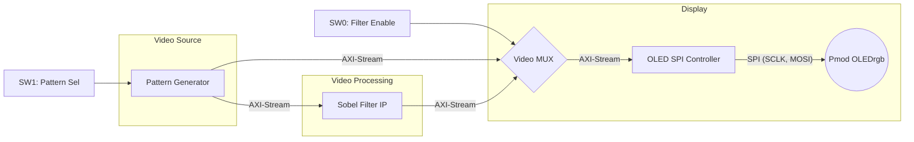
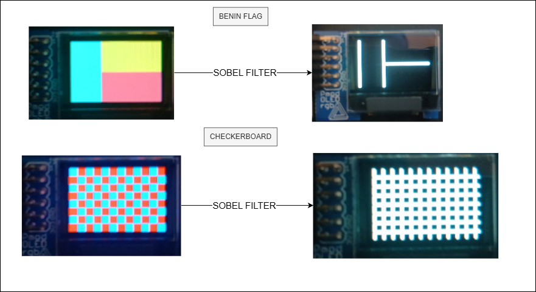

# 📷 Hardware Sobel Edge Detector & OLED Controller

## 📌 Project Overview
This project implements a real-time, hardware-based **Sobel Edge Detection** pipeline on a Xilinx Arty Z7-20 FPGA. The processed video stream is displayed on a Digilent Pmod OLEDrgb (96x64 pixels) using a custom-built SPI controller.

The entire architecture is designed from scratch in **Verilog**, utilizing the **AXI4-Stream** protocol for seamless data transfer and backpressure management.

## ✨ Key Features
* **Custom SPI OLED Controller:** Drives the SSD1331 OLED driver, converting 16-bit RGB565 AXI-Stream pixels into 8-bit SPI transactions.
* **Real-Time Video Pipeline:** Stream-based architecture (no frame buffers) ensuring ultra-low latency.
* **Hardware Sobel Filter:** * Implements a 3x3 sliding window using dual **Line Buffers**.
  * Fully **pipelined (3 stages)** to meet timing constraints at 125 MHz.
  * Handles border artifacts (blanking) and prevents arithmetic overflow.
* **On-the-fly Pattern Generation:** Generates synthetic test patterns (Checkerboard, Benin Flag) without external memory.
* **Hardware Multiplexing:** Instantly toggle the Sobel filter or switch patterns using physical switches.

## 🏗️ Hardware Architecture

The system uses a strictly pipelined AXI-Stream architecture. The "Backpressure" (stall) mechanism is fully supported across all modules using the `tvalid` and `tready` handshake.

## 🎮 How to Use (Arty Z7-20)

- **BTN0 (Reset)**: Resets the entire system and re-initializes the OLED screen.
- **SW0 (Filter Toggle)**: * 
    - `DOWN` = Bypass (Original Image)
    - `UP` = Activate Sobel Edge Detection
- **SW1 (Pattern Select)**: * 
    - `DOWN` = Red & Blue Checkerboard
    - `UP` = Flag of Benin

## 🚀 Future Improvements
This project serves as the foundation for a larger Video Processing System-on-Chip (SoC). Future iterations will include:

1. **Zynq PS Integration**: Using the ARM Cortex-A9 to read .bmp images from an SD Card.

2. **AXI DMA**: Streaming images from DDR3 RAM to the FPGA Fabric.

3. **Dynamic Thresholding**: Adjusting the Sobel sensitivity via AXI-Lite registers.

## Demo

